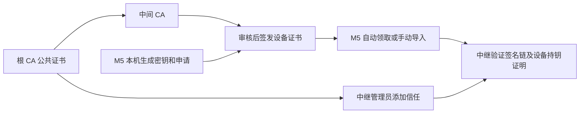

# M5 FMO Client · M5 独立通联终端

让 M5Stack FIRE 类 ESP32 设备直接通过 Wi‑Fi 接入 FMO 中继，使用内置麦克风和扬声器通联。无需手机或电脑转发语音。

**当前版本：v0.7.3。** 已在一台 ESP32、16 MB Flash、GPIO34 模拟麦克风 / GPIO25 DAC 扬声器的 FIRE 类设备上验证。其他 M5 型号请先核对硬件，不能直接等同兼容。

[下载固件](https://github.com/54dashayu/m5-fmo-client/releases/latest) · [刷机与编译](docs/BUILD.md) · [配网和操作](docs/USER_GUIDE.md) · [证书说明](docs/CERTIFICATES.md) · [版本记录](CHANGELOG.md)

## 能做什么

- 独立设备身份，FMO 4.0 证书链校验和 MQTT 登录。
- 半双工语音通联：RADPCM 上行，RADPCM / Opus 下行；8 kHz 语音时钟校准。
- 深色 320×240 中文主页，显示呼号、中继、收发状态、音量及联网状态。
- 三键操作，B 键短按开始 / 再短按停止发话，避免持续按住按键。
- ESP32 自带网页管理：热点配网、2.4 GHz Wi‑Fi 搜索、最多 6 个保存网络、密码显隐。
- 最多 4 个中继配置，可在屏幕菜单选择；切换中继需要对方接纳设备证书。
- 普通用户申请、自动领取和手动导入设备证书；服务器管理员单独下载根证书。
- USB 本机管理备用入口，以及不连接设备的 HTML UI 模拟器。

## 快速开始

1. 核对硬件后，按[刷机说明](docs/BUILD.md)安装固件。
2. 未配网时连接屏幕上的 `M5-FMO-xxxxxx` 热点，输入屏幕显示的 **8 位数字密码**，打开 <http://192.168.4.1>。管理码与热点密码相同，每次重启更新。
3. 在“网络设置”搜索并连接 2.4 GHz Wi‑Fi。连接成功后，可在同一局域网访问屏幕显示的设备 IP。
4. 在证书页面填写自己的呼号、现有 FMO UID，选择设备类型、上传设备照片并提交申请。管理员审核签发后，设备会在空闲联网时自动领取。已有匹配本机公钥的证书包也可手动导入。
5. 等待联网校时、证书有效和中继认证成功，进入“守听中”，即可通联。

**固件不附带任何用户的设备证书或私钥。** 每台设备生成自己的密钥；刷入固件不等于取得登录资格。默认预置“鸡婶婶的测试台”，仍需审核签发有效证书。

## A / B / C 操作

从正面看，三个键自左至右为 A、B、C。长按约 **0.8 秒**。

| 场景 | A | B | C |
| --- | --- | --- | --- |
| 主页短按 | 音量减 | 开始 / 停止发话 | 音量加 |
| 主页长按 | 中继选择 | 强制停止发话 | 打开菜单 |
| 菜单 / 中继列表短按 | 上一项 | 确认 | 下一项 |
| 非主页长按 | 返回主页 | — | — |
| 音量页短按 | 音量减 | 静音切换 | 音量加 |

收话时不抢占发射；切换页面停止发话。单次连续发话上限 60 秒。详细菜单见[使用说明](docs/USER_GUIDE.md)。

## 支持的硬件范围

| 项目 | 本版本配置 |
| --- | --- |
| MCU | 原版 ESP32 双核；实测 ESP32-D0WDQ6-V3 |
| 显示 | 320×240，沿用 M5 Core / FIRE 类屏幕驱动 |
| 按键 | A GPIO39、B GPIO38、C GPIO37 |
| 麦克风 | GPIO34 / ADC1 模拟输入 |
| 扬声器 | GPIO25 / ESP32 内置 DAC |
| 网络 | 2.4 GHz Wi‑Fi |
| Flash | 实测 16 MB；当前分区只使用前 4 MB |
| PSRAM / 灯带 | 本版通联不依赖 PSRAM，未提供灯带功能 |

**不是 M5Core2、CoreS3 或任意 ESP32 板的通用固件。** 没有内置麦克风的 Core、使用数字麦克风 / 外置音频编解码器的板子，需要另做音频适配。

## v0.7.3 的手持发送优化

- 每包从 3 帧 / 240 ms 改为 2 帧 / 160 ms，正常语音 MQTT 消息小于配置的 TCP MSS。
- 最多 4 包的短时发送缓冲，忙碌时非阻塞重试；本地包超过 640 ms 丢弃，防止积累长时间延迟。
- 新发话、断线或接收对方语音时清理未提交的旧包；TCP 已接收的数据不受本地队列超时控制。
- 启用 TCP_NODELAY；连接同名 Wi‑Fi 时按信号选择接入点，保持关闭 Wi‑Fi 省电。

一次实机手持测试中，用户报告不再出现“网络繁忙”；设备记录 51 包提交发送、队列零丢弃，B 停止处理 2 ms，服务器连接未重建。**这是一次实测结果，不保证所有路由器 / 信号条件下零丢包；该次远端听感完整性尚未单独确认。**

## 证书：用户和服务器管理员做不同的事



- **普通用户**需要绑定自己设备公钥的用户证书。下载根证书不能让设备直接登录。
- **服务器管理员**下载本项目的公开根证书，加入自己的 SAS 信任目录，表示接受这套签发链。无需取得 CA 私钥，也不需要导入每台 M5 的用户证书。
- 本项目使用独立的 BH1JSS M5 根 CA，不声称由 FMO 官方根授权。添加信任也不会自动建立服务器集群。

详见[证书申请、导入与服务器信任](docs/CERTIFICATES.md)。

## 项目结构

```text
ui-preview-firmware/   ESP-IDF 固件（沿用开发期目录名，现为可运行终端）
  main/                界面、按键、配网、认证、音频
  components/          随仓库固定的依赖和本地 MQTT 修正
  assets/fonts/        中文字体和 OFL 许可
ui-simulator/          HTML 界面模拟器，不发送真实语音
tools/                 USB 管理、协议测试辅助和本地测试入口
tests/                 主机侧回归测试，不连接生产中继
public-certificates/   公开根 / 中间 CA 证书，不含设备证书和私钥
docs/                  使用、构建、证书和排障说明
```

## 开发与反馈

ESP-IDF **v5.5.1**，目标 `esp32`。仓库包含本地依赖；不要直接替换 MQTT 组件，否则会丢失分片接收和非阻塞发送修正。完整构建、测试命令见 [BUILD.md](docs/BUILD.md)。

提交问题时附硬件型号、固件版本、问题操作和脱敏后的诊断数据；不要上传 Wi‑Fi 密码、设备私钥、证书申请照片或完整身份备份。见 [SECURITY.md](SECURITY.md)。

## 来源与许可

硬件驱动基于 [esp32-fmo-companion](https://github.com/54dashayu/esp32-fmo-companion) 的 M5 适配基础，发展为独立 FMO 客户端。本项目不是官方 FMO 或 AI Passport 固件。

本项目代码采用 [MIT License](LICENSE)，保留原作者 BI8SIG 的版权声明。第三方库、字库分别按各自许可分发，见 [THIRD_PARTY_NOTICES.md](THIRD_PARTY_NOTICES.md)。
