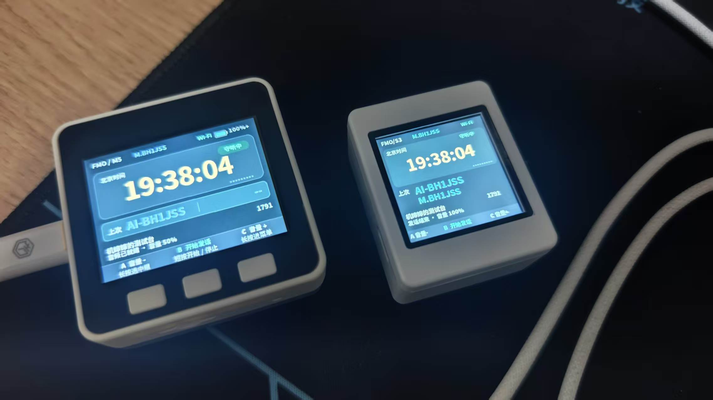
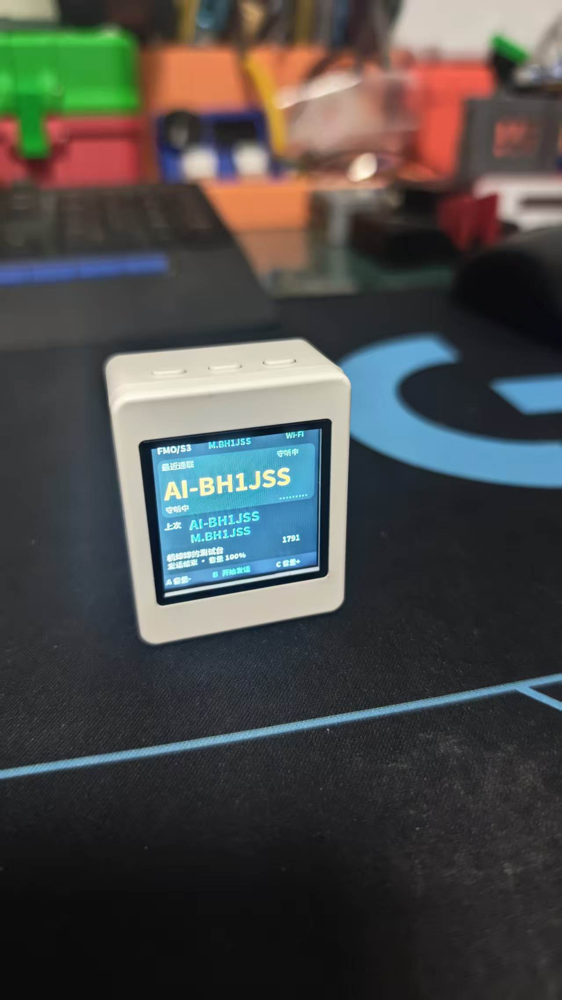
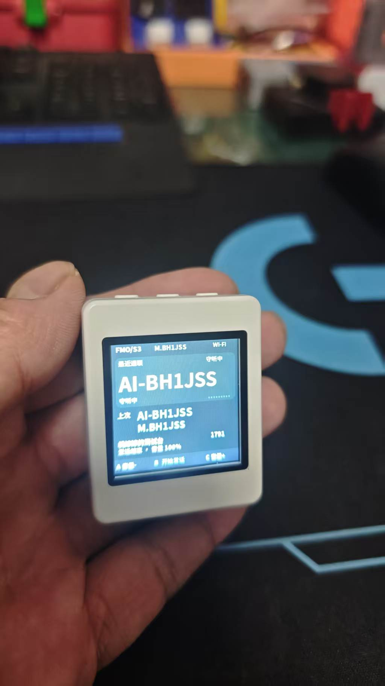
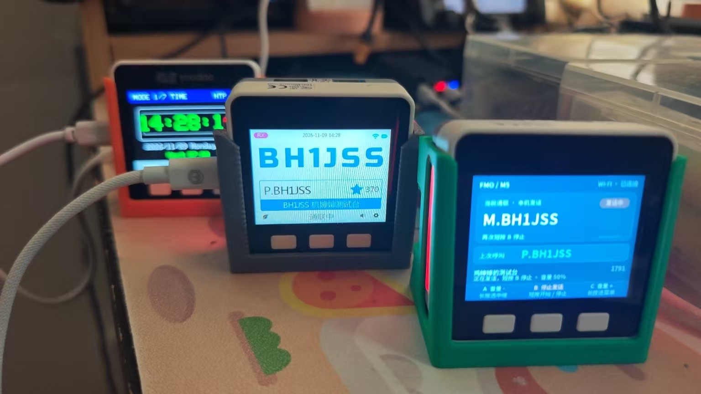
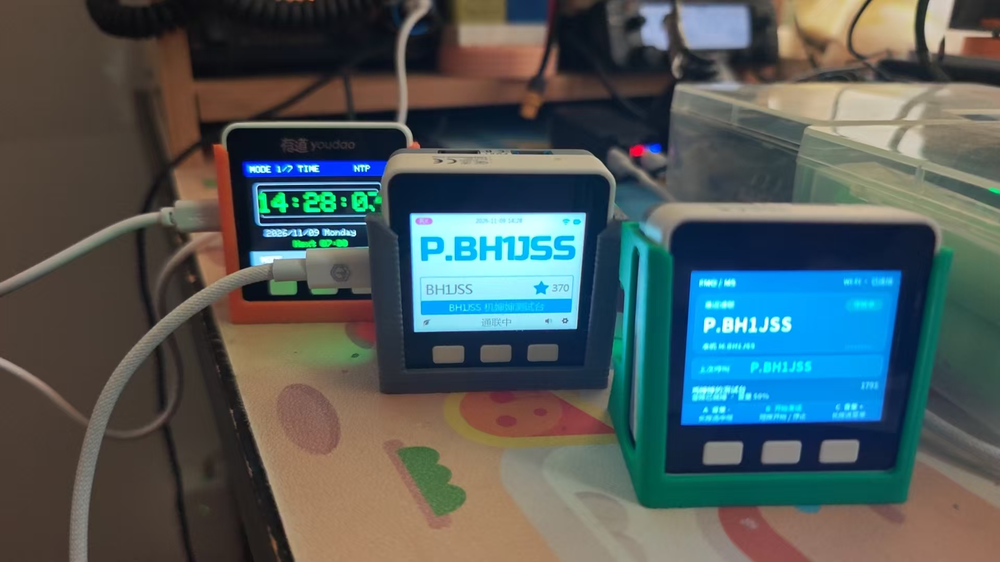
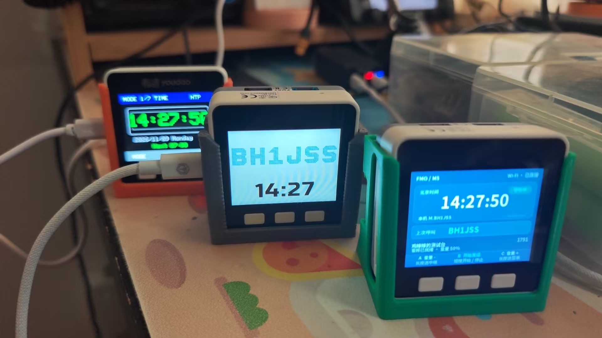
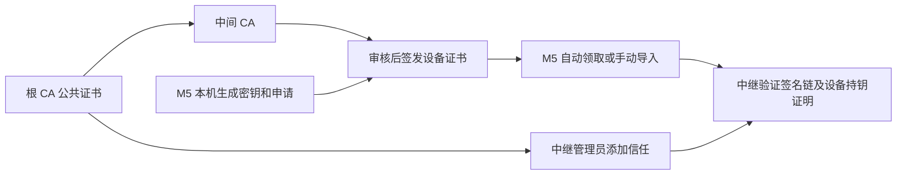

# FMO Client · M5 与小智独立通联终端

让 M5 FIRE 类和 Xingzhi Cube 小智硬件通过 Wi-Fi 独立接入 FMO 中继，使用内置麦克风与扬声器通联。共用源码、分别构建两种板型固件，不能交叉刷写。

**当前版本：M5 0.7.66 / 小智 0.7.64。** 新增 Robot36 SSTV 接收、设备和网页相册、相框导出与浏览器直传照片墙；支持连续等待、手动保存中断图片和资源容量显示。小智修正屏幕传输缓冲及调度等待，呼号与 SSTV 实时显示已通过真机确认。

| 在线刷写硬件选择 | 芯片与外设 | 固件包 |
| --- | --- | --- |
| M5GO / FIRE 类 | 16MB Flash ESP32，320×240，GPIO34 模拟麦克风 / GPIO25 DAC，灯条 | `fmo-m5-fire-v0.7.66.zip` |
| 小智 Xingzhi Cube 1.54 TFT WiFi | ESP32-S3 R8N16，240×240，I2S 麦克风/扬声器，三键 | `fmo-xingzhi-cube-1.54tft-wifi-v0.7.64.zip` |

仅限以上确切板型；M5 Core2/CoreS3 和其他小智设备不能直接等同兼容。已有 FMO 用户选择保留配置升级；原厂小智首次安装前先做整机备份。

[在线刷写](https://app.bh1jss.net/m5-flasher/) · [下载固件](https://github.com/54dashayu/m5-fmo-client/releases/latest) · [刷机与编译](docs/BUILD.md) · [配网和操作](docs/USER_GUIDE.md) · [证书说明](docs/CERTIFICATES.md) · [版本记录](CHANGELOG.md) · [正式版发布流程](docs/RELEASE.md)

> **发布门禁：** 拟发布提交的 GitHub `host-tests` 和 `firmware` 必须全部通过，才能发布正式版并更新在线刷写页面。详见[发布流程](docs/RELEASE.md)。

## 小智与 M5 实机



<details><summary>小智实机外观（界面随版本更新）</summary>





</details>

M5 已完成 SSTV 接收和保存实机测试；小智 0.7.63 的呼号与 SSTV 实时显示已由用户确认正常。0.7.64 修正 M5 进入收图时的栈占用，反复进入、退出测试未再重启；新增相册显式初始化入口和证书自动启用。

M5 0.7.66 改善手台经 FMO 转来的长语音播放；长语音和 SSTV 已通过本地实测，欢迎用户反馈不同网络下的使用情况。见 [M5 更新说明](docs/RELEASE_0.7.66.md)。

版本详情及首次安装注意事项见 [双板发布说明](docs/RELEASE_0.7.64.md)。

## M5 实机展示

右侧绿色底座设备为本项目 M5 FMO 终端，旁边为 Passport。照片由 BH1JSS 提供。



<details>
<summary>查看更多实机照片</summary>





</details>

## 能做什么

- 独立设备身份，FMO 4.0 证书链校验和 MQTT 登录。
- 半双工语音通联：RADPCM 上行，RADPCM / Opus 下行；8 kHz 语音时钟校准。
- 深色 320×240 中文主页，显示当前与上次呼号、中文中继名称；空闲 10 秒切换大字时钟。
- 三键操作，六种功能分配；PTT 支持按住发话和短按保持两种模式。
- ESP32 自带网页管理：热点配网、2.4 GHz Wi‑Fi 搜索、最多 6 个保存网络、密码显隐。
- 最多 4 个中继配置，可在屏幕菜单选择；切换中继需要对方接纳设备证书。
- 普通用户申请、自动领取和手动导入设备证书；服务器管理员单独下载根证书。
- USB 本机管理备用入口，以及不连接设备的 HTML UI 模拟器。

## 稳定版验收

v0.7.14 已在上述 FIRE 类设备验证：下行恢复连贯，上行无明显卡顿，用户确认通话质量可接受，仍有少量噪声。保留中文中继名称、发现列表、空闲时钟和收发呼吸灯。公开包与该次实机验收固件一致，不含 0.7.15 时间戳候选；不同网络及其他型号仍需自行验证。

## 快速开始

1. 核对硬件后，按[刷机说明](docs/BUILD.md)安装固件。
2. 未配网时连接屏幕上的 `M5-FMO-xxxxxx` 热点，输入屏幕显示的 **8 位数字密码**，打开 <http://192.168.4.1>。管理码与热点密码相同，每台设备首次随机生成并保存，重启及保留配置升级不变；更换使用者后重新生成。
3. 在“网络设置”搜索并连接 2.4 GHz Wi‑Fi。连接成功后，可在同一局域网访问屏幕显示的设备 IP。
4. 在证书页面填写自己的呼号、现有 FMO UID，选择设备类型、上传设备照片并提交申请。管理员审核签发后，设备会在空闲联网时自动领取。已有匹配本机公钥的证书包也可手动导入。
5. 等待联网校时、证书有效和中继认证成功，进入“守听中”，即可通联。

**固件不附带任何用户的设备证书或私钥。** 每台设备生成自己的密钥；刷入固件不等于取得登录资格。默认预置“机婶婶的测试台”，仍需审核签发有效证书。

## A / B / C 操作

从正面看，三个键自左至右为 A、B、C。长按约 **0.8 秒**。

| 场景 | A | B | C |
| --- | --- | --- | --- |
| 主页短按 | 音量减 | 开始 / 停止发话 | 音量加 |
| 主页长按 | 中继选择 | 强制停止发话 | 打开菜单 |
| 菜单 / 中继列表短按 | 上一项 | 确认 | 下一项 |
| 非主页长按 | 返回主页 | — | — |
| 音量页短按 | 音量减 | 静音切换 | 音量加 |

收话时不抢占发射；切换页面停止发话。单次连续发话上限 60 秒。详细菜单见[使用说明](docs/USER_GUIDE.md)。

## 支持的硬件范围

| 项目 | 本版本配置 |
| --- | --- |
| MCU | 原版 ESP32 双核；实测 ESP32-D0WDQ6-V3 |
| 显示 | 320×240，沿用 M5 Core / FIRE 类屏幕驱动 |
| 按键 | A GPIO39、B GPIO38、C GPIO37 |
| 麦克风 | GPIO34 / ADC1 模拟输入 |
| 扬声器 | GPIO25 / ESP32 内置 DAC |
| 网络 | 2.4 GHz Wi‑Fi |
| Flash | 实测 16 MB；当前分区只使用前 4 MB |
| PSRAM / 灯带 | 不依赖 PSRAM；FIRE GPIO15 两侧灯带：收绿、发红呼吸、空闲熄灭 |

**不是 M5Core2、CoreS3 或任意 ESP32 板的通用固件。** 没有内置麦克风的 Core、使用数字麦克风 / 外置音频编解码器的板子，需要另做音频适配。

## v0.7.11 中文名称、音频与状态显示

首页和中继菜单使用独立中文字体，覆盖 CJK 基础汉字区。中继菜单同时显示名称与呼号；长名称省略，超出字库的字符以问号代替，网页保留原始名称。

新增240ms接收预缓冲与最长40ms等包窗口、4包接收队列、低音量量化误差反馈和声音起止平滑；麦克风使用实测直流初值、80Hz高通和软限幅，发送队列在20ms采样块间重试。仍使用标准8kHz RADPCM上行与RADPCM/Opus下行，实际听感需在接收设备上验收。

首页连续空闲10秒后以40px加粗数字显示北京时间，通联时切换当前呼号；本机呼号保留小字，下方独立卡片显示上次收到的对方呼号，仅本次开机记录。设备菜单显示1/2或2/2。FIRE两侧10颗GRB灯沿用 [M5 Core V2.0伴侣](https://github.com/54dashayu/fmo-companion-m5core) 的 Espressif led_strip 驱动配置，由RMT硬件驱动，低亮度收绿、发红呼吸，周期1.6秒，空闲灭。

## v0.7.4 发现服务器

设备网页“中继管理”新增公开广播发现列表，支持搜索、刷新和一键添加。成功记录仅来自本机真实 MQTT 登录，并在本次开机中置顶；手动切台不会抹掉该记录，实际接入错误会降低排序。证书更换会清除旧记录。资料来源验证与本机验签、对方登录许可分别显示；添加不会自动切台。手动表单折叠到高级选项。

发现目录由服务器缓存 BG5ESN 的公开 APRS 汇总，浏览器读取，M5 不增加 APRS 长连接。当前来源对独立 QFM 根的覆盖有限，不保证收录 FRlink 全部节点；未验证/过期项目禁用添加。见 [目录实现](discovery-service/README.md)。发布包见 GitHub Releases。

## v0.7.3 的手持发送优化

- 每包从 3 帧 / 240 ms 改为 2 帧 / 160 ms，正常语音 MQTT 消息小于配置的 TCP MSS。
- 最多 4 包的短时发送缓冲，忙碌时非阻塞重试；本地包超过 640 ms 丢弃，防止积累长时间延迟。
- 新发话、断线或接收对方语音时清理未提交的旧包；TCP 已接收的数据不受本地队列超时控制。
- 启用 TCP_NODELAY；连接同名 Wi‑Fi 时按信号选择接入点，保持关闭 Wi‑Fi 省电。

一次实机手持测试中，用户报告不再出现“网络繁忙”；设备记录 51 包提交发送、队列零丢弃，B 停止处理 2 ms，服务器连接未重建。**这是一次实测结果，不保证所有路由器 / 信号条件下零丢包；该次远端听感完整性尚未单独确认。**

## 证书：用户和服务器管理员做不同的事



- **普通用户**需要绑定自己设备公钥的用户证书。下载根证书不能让设备直接登录。
- **服务器管理员**下载本项目的公开根证书，加入自己的 SAS 信任目录，表示接受这套签发链。无需取得 CA 私钥，也不需要导入每台 M5 的用户证书。
- 本项目使用独立的 BH1JSS M5 根 CA，不声称由 FMO 官方根授权。添加信任也不会自动建立服务器集群。

详见[证书申请、导入与服务器信任](docs/CERTIFICATES.md)。

## 项目结构

```text
ui-preview-firmware/   ESP-IDF 固件（沿用开发期目录名，现为可运行终端）
  main/                界面、按键、配网、认证、音频
  components/          随仓库固定的依赖和本地 MQTT 修正
  assets/fonts/        中文字体和 OFL 许可
ui-simulator/          HTML 界面模拟器，不发送真实语音
tools/                 USB 管理、协议测试辅助和本地测试入口
tests/                 主机侧回归测试，不连接生产中继
public-certificates/   公开根 / 中间 CA 证书，不含设备证书和私钥
docs/                  使用、构建、证书和排障说明
```

## 开发与反馈

ESP-IDF **v5.5.1**，目标 `esp32`。仓库包含本地依赖；不要直接替换 MQTT 组件，否则会丢失分片接收和非阻塞发送修正。完整构建、测试命令见 [BUILD.md](docs/BUILD.md)。

提交问题时附硬件型号、固件版本、问题操作和脱敏后的诊断数据；不要上传 Wi‑Fi 密码、设备私钥、证书申请照片或完整身份备份。见 [SECURITY.md](SECURITY.md)。

## 来源与许可

硬件驱动基于 [esp32-fmo-companion](https://github.com/54dashayu/esp32-fmo-companion) 的 M5 适配基础，发展为独立 FMO 客户端。本项目不是官方 FMO 或 AI Passport 固件。

本项目代码采用 [MIT License](LICENSE)，保留原作者 BI8SIG 的版权声明。第三方库、字库分别按各自许可分发，见 [THIRD_PARTY_NOTICES.md](THIRD_PARTY_NOTICES.md)。

## 上一版：0.7.17-dev / home-r6

历史测试版新增：新增更换使用者、在线重新申请与管理员证书包导入，首页显示最近两个不同呼号（左大右小）。普通用户不再下载申请文件。

已在 M5 上刷写校验，确认启动、联网、证书和服务器接入正常；部分设备的长语音播放卡断及扬声器无声仍在排查。本版不声明修复音质问题。0.7.14 稳定版保留供回退。

首页 home-r6 已经真机确认：顶部显示“本机：”及呼号，与 FMO / M5 同字号；当前呼号 36 号、时钟 48 号，均为金色；空闲 10 秒显示时钟，隐藏重复的守听提示。最近两个呼号分别为 20/18 号同色粗体，AI-BH1JSS 不缩小，超长呼号滚动。

## 上一正式版：0.7.18 空闲省电

连续 300 秒无收发、无按键，LCD 背光降至 3%；收到语音、发话或任意按键恢复 100%。按键继续执行原有动作，Wi-Fi 和中继保持连接，通联音频路径不变。此版本已作为正式版提供在线刷写及 GitHub 下载。3% 亮度已由用户实机确认；300 秒边界及活动恢复逻辑已通过自动测试。实际续航提升尚未测量，旧版本保留回退。

## 历史正式版：0.7.19 中继管理

已保存中继支持删除，网页与 M5 菜单同步；当前中继需先切换，通联中禁止删除。临时条目的添加、删除、重启保存已在实机验证。已验证本机接入的节点与管理员指定的西南集群节点优先，明确区分验证记录与管理员指定，不声称自动得知对方根 CA 配置。验证记录在本次开机有效，更换证书后清除。

后台固定文案改为“机婶婶”。默认测试台旧拼写会迁移；发现的其他中继名称保持来源原名。刷新有效发现目录时，仅在 UID、呼号、地址、端口、指纹全部匹配且来源验证通过时更新已保存名称，不改变连接目标。保留 0.7.18 的 300 秒/3% 背光省电功能。

## 历史正式版：0.7.20 电量显示

首页顶部去掉“本机：”前缀，保留呼号，新增电池图标和档位电量。IP5306 每 5 秒在后台读取一次，支持 0/25/50/75/100% 档位；“+”表示芯片报告充电状态，不等于已测得充电电流。读取失败显示“--”，不会用 USB 连接状态推算满电。已实机读到 100% 档位与充电状态，联网与音频初始化正常。保留省电和中继管理功能。

## 历史正式版：0.7.21 双音尾音

正常按 B 结束本机发话时，向对方发送 500 Hz 低音、短停顿、1000 Hz 高音，总长约 320 毫秒。尾音带渐入渐出，使用与正常上行一致的单帧 RADPCM 数据包；异常断线、频道正在接收或本次发送拥堵时跳过尾音。修正历史丢包计数导致后续通话尾音被持续跳过的问题。

双音测试实现已在 M5 上由用户确认对方能够听到，正式版仅移除测试版本标识。保留电量显示、中继管理、证书与省电功能。原有部分设备长语音卡断或扬声器无声问题不属于本次修复范围。

## 历史版本：0.7.22 固定管理码与自动发现

- 每台设备使用固定八位数字管理码，保留配置升级与重启不变；更换使用者时重新生成。
- 网页勾选“记住此浏览器”后保存独立授权，跨设备重启有效；退出登录撤销此授权，更换使用者清除旧浏览器授权。最多记住四个浏览器；更换 IP/访问地址或清除浏览器数据后需重新输入管理码。
- 中继菜单末项“发现中继”提供自动发现和直接接入，已保存名额满时临时接入，不覆盖原列表；重启恢复已保存默认中继。
- 不再按“西南集群”等名称优先或判定信任。目录服务器校验当前启用根 CA 的证书链和 APRS 签名；M5 校验目录签名，再以本机证书做不发送语音的短连接认证。只有接入成功节点进入发现列表。
- 独立根 CA 仍需其公开中间证书才能验证广播。分批发现不保证覆盖全网，长期运行和高负载通联仍需进一步验证；旧版 0.7.21 与 0.7.14 保留回退。

## 开发验证：0.7.23

网页发现页显示本批全部候选名称、呼号、UID 和验证状态，已验证节点置顶，其他候选等待自动验证而不能直接接入。区分待验证、正在验证、暂未验证成功及广播过期，失败不等于未互信。已保存中继列表随状态轮询更新，避免认证成功后仍显示旧标签；未验证文案明确为“本次启动尚未验证”。此开发改进已合入 0.7.24 正式版。


0.7.23-dev：撤销 AI Passport #1845 的特殊确认名单。所有节点统一通过有效广播和证书链校验进入候选列表，本机认证接入成功后才允许选择加入。导入对方根 CA 仅表示本方接受对方证书，不代表对方信任本机。

发现页支持手动“添加到列表”：仅保存有效广播的连接资料，不自动切换、不升级认证状态。可之后选择连接尝试，或等待自动验证。接入失败不会被标为互信；过期广播和过期页面索引不能添加。

中继选择页：常用中继扩至 8 个，每页 4 项，标题显示当前页/总页数。A/C 上下选择并自动跨页，B 确认，长按 A 返回；发现中继作为最后一项。旧版保存的中继配置继续兼容。

0.7.24-dev：取消固定中继数量上限。中继逐条存入设备 NVS，实际容量由剩余存储空间决定；网页每页读取 8 条、屏幕每页显示 4 条，仅缓存少量记录。首次升级自动迁移原列表；存储不足时返回错误并保留已有列表。新记录存入新格式，回退旧固件只会读取迁移前的旧列表。

## 历史版本：0.7.24 中继列表与分页

- 取消固定收藏数量上限，按设备剩余存储保存；M5 每页四项，网页每页八条，发现入口金色突出。
- 展示已验签广播候选及各自接入状态；本机接入已验证优先。允许手动保存候选，保存不等于互信或接入成功。
- 已保存中继支持删除；名称遵循广播，取消特定服务器的特殊放行。
- 管理员页提供可下载 HTML 连接与互信指南。
- 实机验证原有五条中继迁移、九条分页保存和重启持久化，测试后恢复原有条目；保留现有音频、双音尾音及空闲省电功能。

升级保留身份和 Wi-Fi。新列表使用独立存储格式；回退旧固件仅能读取迁移前的旧列表。实际容量受 NVS/内存限制，并非无限。正式产物校验见 Release SHA256SUMS。

## 历史版本：0.7.25 接收缓冲优化

按实际包长存放接收语音，减少短 Opus 包挤满固定包位造成的溢出；按语音时长预缓存，空间紧张时提前播放。保持 8 kHz 和原有上行编码、双音尾音功能。完整离线回归通过；同功能开发构建已在 1791 点名中接收友台 Opus 和 AI RADPCM，观察期间没有队列溢出、解码或输出错误，用户确认声音明显连贯。长期负载仍需验证。

## 历史版本：0.7.26 M5 呼号前缀

发送语音和双音尾音的包头呼号统一为 `M.呼号`（例如 `M.BH1JSS`）；证书、MQTT 登录和 UID 不变。用户已实测确认仪表盘显示 M. 且语音正常。保留 0.7.25 的接收缓冲优化。第三方服务器的 AI/点名解析应区分带前缀的显示身份与证书裸呼号；1791 已兼容。

## 历史版本：0.7.27 多证书体系

M5 菜单“设备身份”或网页“本机设备证书”可选择已安装的身份。确认后自动重启，恢复该体系的中继收藏、选择位置及独立接入记录，并刷新广播候选。屏幕与网页会标明当前体系。首次升级将原收藏地址分别复制到各体系，接入结果重新验证；后续添加、删除和选择互不影响。接入历史绑定具体设备证书，换证后不沿用旧结果。历史成功不是永久授权。

BI4TES 申请仍由原服务审核签发；领取适配器不签发证书。新根 CA 仅保存信任锚，须获得该签发方匹配本机密钥的设备证书。迁移完整身份后禁止原设备同时登录。完整说明见 [多体系证书说明](docs/BI4TES_CERTIFICATES.md)。设备软件不能替代签发方人工审核、在线吊销策略或服务器最终接入判定。

保存数量受设备 NVS 空间限制。0.7.26 回退读取升级前的共同列表，不读取新版本各体系新增的收藏。

BH1JSS、BI4TES 的申请与领取任务分别持久保存，切换身份不会停止其他体系的任务。新证书验证通过后保存到对应身份库，由用户手动切换，不打断当前通联。内置五套公共根，不含任何设备证书或私钥。已有设备请在在线刷写页选择 **保留配置升级**；不要执行更换使用者或清空 Flash。

## 历史版本：0.7.28 先选择体系，再申请证书

网页和 M5 设备身份菜单可选择尚无设备证书的根 CA 体系。确认后重启并暂停通联，保留其他体系的证书和密钥；随后按所选体系申请、领取或导入证书。只有证书验证通过并启用后才进行认证接入。已有领取任务继续使用原申请密钥，各体系独立保存，仍可切回原身份。

使用在线刷写页默认的“保留配置升级”，只写应用区，不擦除根 CA、设备证书、私钥、Wi-Fi 或中继收藏。新设备固件仅含公共根证书，不含个人身份。已在新 M5 上验证保留身份升级、BI4TES 自动领取和切换后中继认证；未重新验收本版实体按键操作及长时间语音。

## 0.7.29 体系默认中继

从网页或 M5 菜单确认切换体系后，BH1JSS M5 自动选择机婶婶的测试台（1791），BI4TES 自动选择 AI PASSPORT互通（1845）。若当前体系列表缺少该节点，则补充已核实的公开连接资料。已有节点保留其保存的名称、地址和指纹；仍须通过真实认证，不预先授予接入状态。其他体系不受影响。普通重启保留手动选择，不强制切回默认台。升级保留根 CA、各体系设备证书和配置。
